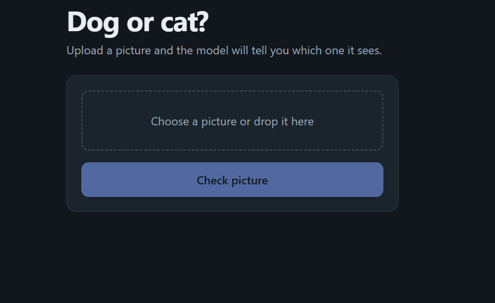

<div align="center">

# 🐶 Dog vs Cat Classifier 🐱

**A deep learning web app that tells you whether a picture shows a dog or a cat.**

Built with transfer learning (MobileNetV2), served with Flask, and deployed for free on Vercel.

[](https://www.python.org/)
[](https://www.tensorflow.org/lite)
[](https://flask.palletsprojects.com/)
[](https://vercel.com/)

[**🚀 Live Demo**](https://YOUR-APP-NAME.vercel.app) · [**📓 Training Notebook**](dogs_vs_cats_classifier.ipynb)

</div>

---

## 📸 Preview

> Add a screenshot of your app here. Upload the image to your repository and replace the line below.



---

## ✨ Features

- **Instant predictions:** upload a picture and get a result in seconds.
- **Confidence scores:** see the dog and cat percentages, not just a label.
- **Drag and drop:** works with JPG and PNG images on desktop and mobile.
- **Lightweight model:** the TFLite model is only a few MB, so it runs on a free server.
- **Dark mode support:** the page follows your device theme.

---

## 🧠 How It Works

```
 Picture ──► Resize to 224×224 ──► MobileNetV2 (pre-trained) ──► Dense layer ──► Dog or Cat
```

1. The browser shrinks your picture to 224 × 224 pixels and sends it to the server.
2. The Flask back end passes it to the TFLite model.
3. The model returns a number between 0 and 1. Close to **1** means **dog**, close to **0** means **cat**.
4. The page shows the answer with confidence bars.

### Model details

| Item | Details |
|---|---|
| Approach | Transfer learning |
| Base model | MobileNetV2 (ImageNet weights, frozen) |
| Input size | 224 × 224 × 3 |
| Data augmentation | Random flip, rotation, and zoom |
| Output layer | 1 neuron with sigmoid activation |
| Loss / Optimizer | Binary cross-entropy / Adam (learning rate 0.001) |
| Training | Up to 5 epochs with early stopping |
| Data split | 80% train, 10% validation, 10% test |
| Test accuracy | 99.16%  |

---

## 🛠️ Tech Stack

| Part | Tools |
|---|---|
| Model training | Python, TensorFlow, Keras, scikit-learn, pandas, NumPy |
| Model format | TensorFlow Lite |
| Back end | Flask, ai-edge-litert, Pillow |
| Front end | HTML, CSS, JavaScript |
| Hosting | Vercel (free Hobby plan) |
| Training platform | Google Colab |

---

## 📂 Project Structure

```
dog-cat-vercel/
├── app.py                          # Flask app: web page + /predict endpoint
├── dog_cat.tflite                  # Trained TFLite model
├── requirements.txt                # Python packages for deployment
├── dogs_vs_cats_classifier.ipynb   # Notebook used to train the model
└── README.md
```

---

## 🚀 Run It Locally

**1. Clone the repository**

```bash
git clone https://github.com/YOUR-USERNAME/dog-cat-vercel.git
cd dog-cat-vercel
```

**2. Install the packages**

```bash
pip install -r requirements.txt
```

**3. Start the app**

```bash
python app.py
```

**4. Open your browser** at `http://127.0.0.1:5000`

> If `ai-edge-litert` does not install on your computer, run the app on Linux or macOS, use WSL on Windows, or use the live demo instead.

---

## 🏋️ Train the Model Yourself

1. Open `dogs_vs_cats_classifier.ipynb` in [Google Colab](https://colab.research.google.com/).
2. Turn on the GPU: **Runtime → Change runtime type → T4 GPU**.
3. Upload your `kaggle.json` API key when the notebook asks for it.
4. Run all cells in order.
5. The last cell downloads `dog_cat.tflite`, which is the model the app uses.

---

## ☁️ Deploy to Vercel

1. Push this repository to GitHub.
2. Sign in at [vercel.com](https://vercel.com/) with your GitHub account.
3. Click **Add New → Project**, choose this repository, and click **Import**.
4. Click **Deploy**. Vercel detects Flask automatically.

Full TensorFlow is too large for Vercel, which is why this project uses the small TFLite model.

---

## 📊 Dataset

The model was trained on the [Dogs vs. Cats Redux: Kernels Edition](https://www.kaggle.com/c/dogs-vs-cats-redux-kernels-edition) dataset from Kaggle, which has 25,000 labeled training pictures (12,500 dogs and 12,500 cats).

---

## 🔮 Future Improvements

- [ ] Fine-tune the top layers of MobileNetV2 for higher accuracy
- [ ] Support more animal classes
- [ ] Add a webcam mode for live predictions
- [ ] Show a Grad-CAM heat map to explain what the model looks at

---

## 👤 Author

Zeeshan Ahmad


</div>
